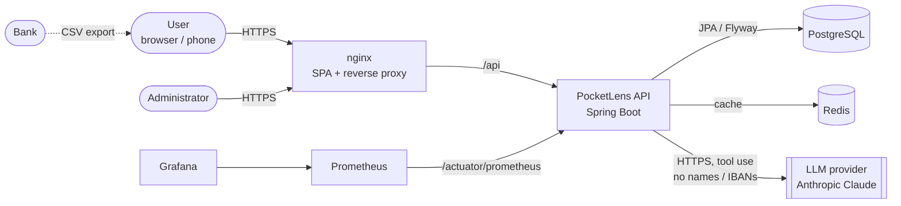
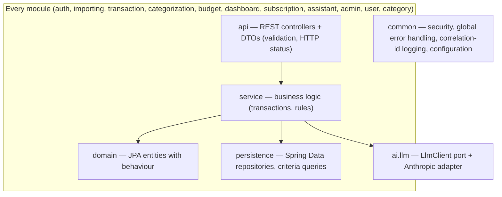
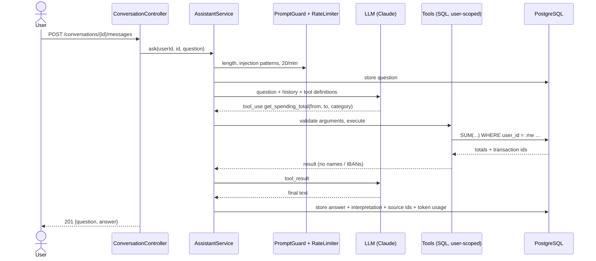
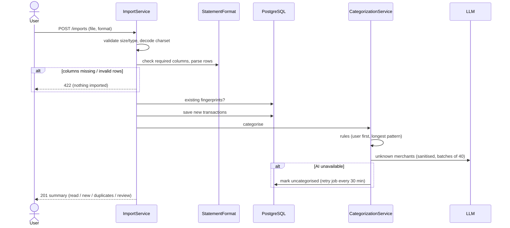
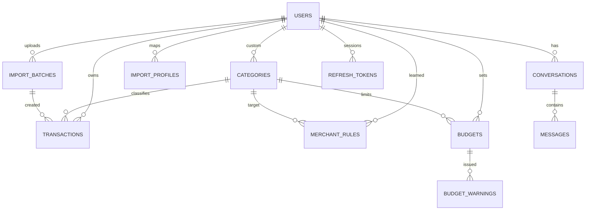
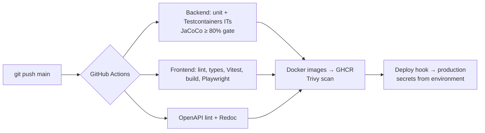

# Architecture overview

## System context

## Backend: modular monolith with layered modules

Each business module is a package with the same four layers; dependencies point downwards only.

| Module | Responsibility | Key classes |
|---|---|---|
| auth / user | Registration with consent, login, JWT + rotating refresh tokens, export, deletion | `AuthService`, `TokenService`, `UserService` |
| importing | CSV decoding, bank formats, column mappings, de-duplication | `ImportService`, `StatementFormat` (+ Revolut, Wise, EU, generic, mapped) |
| categorization | Merchant normalisation, rules, AI classifier, PII removal, retry job | `CategorizationService`, `RuleEngine`, `AiCategorizer`, `PiiSanitizer` |
| transaction | Search/filter/sort, corrections with rules, DB aggregations | `TransactionService`, `TransactionAggregates`, `TransactionSpecifications` |
| budget | Budgets, linear projection, warnings | `BudgetService`, `BudgetProjection` |
| dashboard | Cached read model per user and month | `DashboardService` |
| subscription | Recurring-payment detection | `SubscriptionDetector` |
| assistant | Tool-calling loop, tools, prompt guard, rate limit, conversations | `AssistantService`, `AssistantTool` implementations |
| admin | Default categories, global rules, usage statistics | `AdminController`, `AdminStatsService` |

**SOLID in practice:** one responsibility per service (e.g. `CategoryUsageCleaner` implementations per module);
open/closed extension points (`StatementFormat`, `AssistantTool` — a new bank or assistant capability is one new
class); business logic depends on the `LlmClient` interface, not on the provider (dependency inversion, mocked in
tests); small interfaces (`CategoryUsageCleaner` has one method).

## Request flow: asking the assistant (UC-2)

## Request flow: importing a statement (UC-1)

## Data model

All user-owned tables cascade on user deletion (GDPR Art. 17). Indexes follow the access paths:
`(user_id, booking_date)`, `(user_id, category_id, booking_date)`, `(user_id, merchant)`, partial indexes for the
review queue and waiting transactions, unique `(user_id, fingerprint)` for de-duplication.

## Cross-cutting concerns

| Concern | Implementation |
|---|---|
| Error handling | `GlobalExceptionHandler` + security entry point → RFC 9457 problem details with stable codes |
| Logging | Structured JSON (ECS) to stdout; correlation id per request in MDC and `X-Correlation-Id`; no transaction texts or chat content in logs |
| Caching | Dashboard read model in Redis (10 min TTL, evicted on every data change) |
| Monitoring | Actuator health/liveness/readiness, Micrometer → Prometheus → Grafana |
| Configuration | Environment variables only (`.env.example`); secrets never in the repository |
| Security | BCrypt(12), JWT HS256 (Nimbus), refresh-token rotation, input validation, user-scoped queries, PII sanitiser before LLM calls, prompt-injection filter, rate limit |

## Deployment and CI/CD

## Key decisions

| Decision | Alternatives | Reason |
|---|---|---|
| Modular monolith | Microservices | One developer, one deployable; modules keep boundaries so services can be extracted later |
| LLM chooses tools, SQL computes | LLM reads raw transactions | Correct, verifiable numbers; less personal data sent; cost independent of data volume |
| Own Anthropic client (Spring `RestClient`) behind `LlmClient` | Spring AI | Explicit tool loop, retries and PII control; no extra framework; provider replaceable |
| Hand-written OpenAPI as contract + contract test | Code-generated docs only | Documentation written for people, still verified against code |
| JWT in memory + HttpOnly refresh cookie | Token in localStorage | Not readable by injected scripts |
