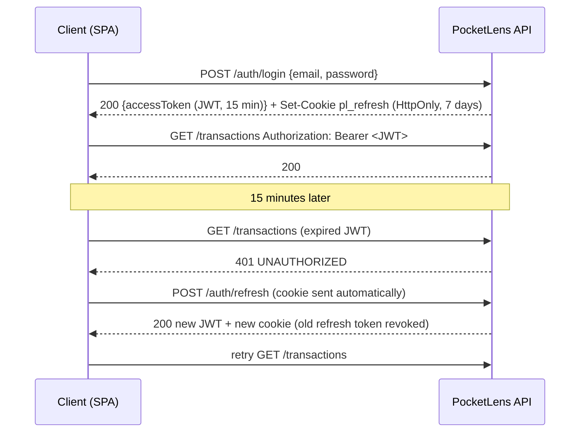

# Authentication and authorization

## Tokens

| | Access token | Refresh token |
|---|---|---|
| Format | JWT, HS256, standard Nimbus/Spring Security implementation | 256-bit random, Base64URL |
| Lifetime | 15 minutes (`JWT_ACCESS_TTL`) | 7 days (`JWT_REFRESH_TTL`) |
| Transport | `Authorization: Bearer` header | `pl_refresh` cookie: `HttpOnly; SameSite=Strict; Path=/api/v1/auth; Secure` in production |
| Storage (server) | not stored (stateless) | only the SHA-256 hash, in `refresh_tokens` |
| Storage (browser) | memory only (never localStorage) | cookie, unreadable by JavaScript |
| Claims | `sub` (user id), `roles`, `iss`, `iat`, `exp` | — |

**Rotation and reuse detection.** Each refresh revokes the used refresh token and issues a new one. Presenting an
already revoked token is treated as theft: all sessions of the user are revoked.

## Authorization

* Roles: `USER`, `ADMIN`. `/api/v1/admin/**` requires `ADMIN` (`403 FORBIDDEN` otherwise).
* **Data isolation:** every query is filtered by the user id from the token. Another user's resource answers
  `404 NOT_FOUND` (not 403), so ids cannot be probed. Covered by `DataIsolationIT`.

## Passwords

BCrypt with cost 12; 10–72 characters with at least one letter and one digit. Login errors never reveal whether an
e-mail exists.

## Security warnings for integrators

* Never log or persist access tokens; never put them in URLs.
* Always use HTTPS in production (`COOKIE_SECURE=true`).
* The refresh cookie only works when the client is served from the same site as the API (the SPA is served by the
  same nginx that proxies `/api`). Cross-site clients must use CORS with credentials and an allowed origin
  (`CORS_ALLOWED_ORIGINS`).
* `JWT_SECRET` must be ≥ 32 random bytes and kept in a secret store / environment variable — the application refuses
  to start with a shorter secret.
