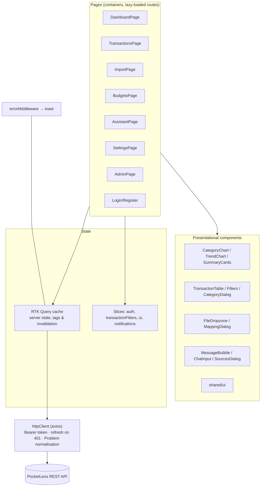
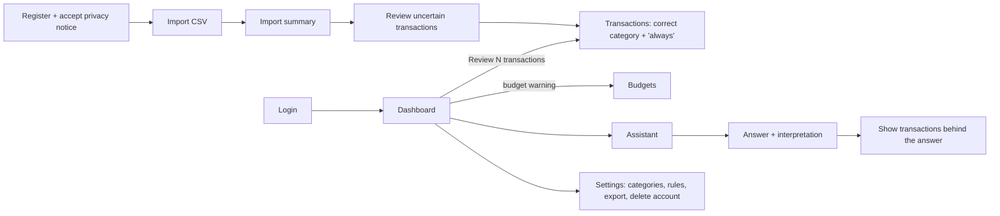

# Frontend architecture

Single-page application: **React 19 + TypeScript (strict) + Vite**, Material UI, Redux Toolkit with RTK Query,
React Router (lazy routes), React Hook Form + Zod, Recharts.

## Structure (feature-sliced)

```
src/
  app/          store, router (lazy routes), theme, global error middleware, UI slice (theme)
  layout/       AppLayout (responsive drawer + top bar), Logo
  features/     one folder per domain feature: page(s), components, API endpoints, slices, schemas, tests
    auth/ dashboard/ transactions/ import/ budgets/ assistant/ settings/ admin/ notifications/
  shared/
    api/        httpClient (axios: token, refresh-on-401, error normalisation) + baseApi (RTK Query)
    ui/         reusable components: PageHeader, EmptyState, skeletons, Money, MonthPicker, ConfirmDialog,
                ErrorBoundary, QueryError
    lib/        formatting, logger
    types/      API types (mirror of the OpenAPI contract)
  test/         test setup, MSW server, render helper
e2e/            Playwright tests (desktop + mobile)
```



## Architectural approach

* **Component-based with container/presentational split.** Pages fetch data and orchestrate; components receive
  props and are reusable/testable (e.g. `TransactionTable` knows nothing about the API).
* **Flux / Redux Toolkit.** Server state lives in the RTK Query cache (deduplication, caching, loading flags,
  tag-based invalidation: a correction invalidates `Transactions`, `Dashboard`, `Rules`). Client state that several
  pages share lives in slices: session (`auth`), transaction filters (survive navigation, set from the dashboard's
  "Review" button), theme, notifications. Local UI state (dialogs, form inputs) stays in components.
  Memoised selectors (`createSelector`) map filters to query parameters.
* **Centralised API access.** One axios instance adds the token, refreshes an expired session once (concurrent 401s
  share one refresh) and converts every failure into the API's problem format.

## Error handling and loading states

| Layer | Mechanism |
|---|---|
| HTTP | `401` → silent refresh + retry, else logout to `/login`; all errors normalised to `Problem` |
| Global | `errorMiddleware` turns `403`, `429`, `5xx`, `503`, network errors into a snackbar (with correlation id for 5xx) |
| Inline | validation, conflicts, import errors (missing columns, row errors), prompt rejection, wrong credentials shown next to the form |
| `404` | Page shows "not found" (catch-all route) / resources show `QueryError` |
| Rendering | `ErrorBoundary` around the app and around each page (reset on navigation) |
| Loading | Skeletons shaped like the content for every async view, button spinners, assistant typing indicator |
| Logging | `logger` writes errors with context (URL, status, code, correlation id); unhandled rejections are logged |

## Routing (guards in `RequireAuth`)

`/login`, `/register` (public only) · `/` dashboard · `/transactions` · `/import` · `/budgets` ·
`/assistant[/:conversationId]` · `/settings` · `/admin` (role ADMIN) · `*` not found.

## User flows



## Responsive and accessible UI

* Breakpoints: permanent navigation drawer ≥ 900 px, temporary drawer below; the transaction table becomes a card
  list on phones (no horizontal scrolling from 360 px, NFR-U2). E2E tests run on desktop and Pixel 7 viewports.
* WCAG 2.1 AA: contrast-checked palette in light and dark themes, labels on all inputs and icon buttons, keyboard
  operable file dropzone, `aria-live` for import results and chat, charts have text equivalents (category list).
* Light/dark theme toggle (stored per browser, defaults to the OS preference).

## Performance

Route-level code splitting (every page is a lazy chunk), vendor chunks (react, mui, charts, state) for long-term
caching, memoised chart components, debounced search (350 ms), hashed assets cached for one year by nginx.

## Tech stack justification

| Choice | Why | Alternatives considered |
|---|---|---|
| React + TypeScript | Largest ecosystem, strict typing of API contracts, author's experience | Angular (heavier for one developer), Vue |
| Vite | Fast dev server and builds, native ESM, Vitest integration | Webpack/CRA (CRA is deprecated) |
| Material UI | Accessible, complete component set (tables, dialogs, forms), theming incl. dark mode | Ant Design, custom components |
| Redux Toolkit + RTK Query | Global state and server cache in one tool, devtools, memoised selectors, tag invalidation | Zustand + TanStack Query (two libraries) |
| React Hook Form + Zod | Uncontrolled forms (few re-renders), schemas mirror backend validation and give typed values | Formik + Yup |
| Recharts | Declarative charts in React, responsive | Chart.js (imperative), D3 (low level) |
| Vitest + Testing Library + MSW | Fast unit/component tests against a mocked network layer | Jest |
| Playwright | Reliable e2e on real browsers, mobile emulation, traces | Cypress |
| ESLint (typescript-eslint, react-hooks) + Prettier | Enforced code quality and formatting in CI (`--max-warnings 0`) | — |

## Tests

* Unit/component (Vitest): `LoginPage` (validation, success, wrong credentials), `TransactionTable` (rendering,
  sorting, editing), `BudgetForm` (validation, parsing), `MessageBubble` (interpretation, sources),
  `httpClient` (refresh-and-retry, session expiry, error normalisation), filters slice, formatting.
* E2E (Playwright, desktop + mobile): login → dashboard with budget warning; import → summary;
  assistant question → interpretation → transactions behind the answer.
